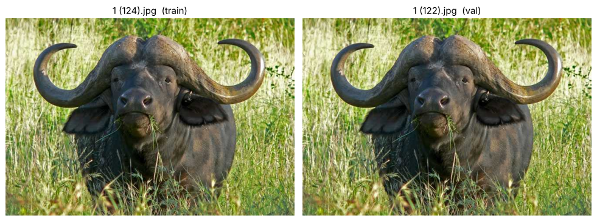
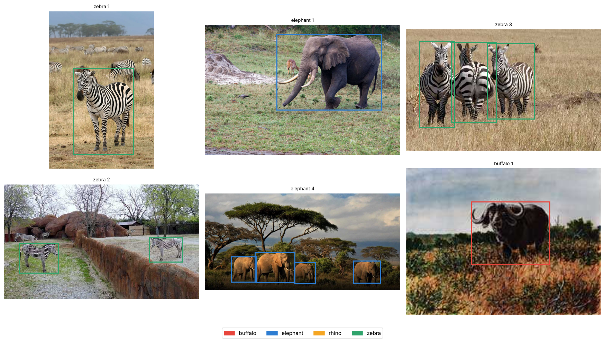

# African wildlife detection (YOLO11n)

Object detection on photos of African animals: **buffalo, elephant, rhino,
zebra**.

[](https://colab.research.google.com/github/USER/REPO/blob/main/notebooks/wildlife_detection.ipynb)

> Replace `USER/REPO` in the badge with your GitHub username and repository
> name after you push this repo.

Everything — download, the label checks, both training runs, evaluation and the
failure analysis — runs top to bottom in `notebooks/wildlife_detection.ipynb`
from a fresh Colab runtime on a free T4 GPU. After every part a short cell
prints what the numbers mean, so the text always matches the run.

---

## 1. Dataset

| | |
|---|---|
| Name | African Wildlife |
| Source | https://docs.ultralytics.com/datasets/detect/african-wildlife/ |
| Download | https://github.com/ultralytics/assets/releases/download/v0.0.0/african-wildlife.zip (100 MB) |
| Licence | **AGPL-3.0** — the dataset ships its own `LICENSE.txt`, and Ultralytics YOLO is AGPL-3.0 as well, so this repository is published under the same terms |
| Photos | 1504 JPEG, different sizes (web photographs) |
| Annotation format | YOLO `.txt`, one per photo: `class cx cy w h`, normalised to 0..1 |
| Classes | buffalo, elephant, rhino, zebra |

The dataset already ships train / val / test folders, so no split was invented.
One correction was needed (section 1.2).

### 1.1 Split and object counts

From `scripts/check_dataset.py`:

| Split | Photos | Animals | buffalo | elephant | rhino | zebra |
|---|---|---|---|---|---|---|
| train | 1052 | 1931 | 399 | 558 | 399 | 575 |
| val | 225 | 379 | 89 | 91 | 85 | 114 |
| test | 227 | 375 | 66 | 99 | 75 | 135 |
| **total** | **1504** | **2685** | **554** | **748** | **559** | **824** |

The classes are well balanced — the biggest class has only about 1.5× the
objects of the smallest. That matters: with a 10× imbalance a model can ignore
the rare class and still look good on the average.

Measured object sizes — the box as a share of the photo, not in pixels, because
the photos have different sizes:

| class | animals | median box side |
|---|---|---|
| buffalo | 554 | 56% of the photo |
| rhino | 559 | 55% |
| elephant | 748 | 42% |
| zebra | 824 | 38% |

Animals per photo: min 1, **median 1**, max 25. So this is mostly a
"find one big object" task. That measurement is what the experiment in
section 2 is built on.

Label checks: **0** photos without a label file, **0** empty labels, **0** boxes
outside the image. 17 boxes cover more than 90% of the photo (close-ups).

### 1.2 The same photo in two splits

File names are all different, but the same photo appears twice under two names.
Hashing every photo (64-bit difference hash on a 9×8 grayscale thumbnail) and
comparing all pairs finds:

| | pairs |
|---|---|
| near-duplicate pairs in total (distance ≤ 8) | 75 |
| inside one split (train–train, val–val, test–test) | 38 |
| **crossing a split boundary** | **37** |
| of the crossing ones, byte-for-byte identical files | 21 |

37 pairs put the same photo in two different splits — most of them train↔test.
Testing on a photo the model trained on makes the score look better than it is.



**The fix.** The training copy is removed, so the evaluation photo stays and the
model has never seen it. Moving the photo into train instead would shrink the
test set, which is already small. The rule has no random part:

> if the same photo is in two splits, delete the copy that is in train;
> if neither copy is in train, delete the one in test.

Result: **36 photos removed**, split goes from 1052/225/227 to
**1018/225/225**, and **0** near-duplicate pairs cross a split afterwards.
Duplicates inside one split are left alone — the task only asks for copies to
stay on the same side.

The notebook does not copy 1500 files to apply this. It writes
`lists/{train,val,test}.txt` with the photos it keeps and points `data.yaml` at
those lists.

### 1.3 A label convention worth knowing

When a herd stands behind the main animal, the background animals usually have
**no box** — the labels mark what the photo is about, not every animal in it.
This cannot be fixed here, but it changes the score: a correct detection of a
background zebra counts as a false positive. Section 4 measures how often that
happens instead of assuming it.



---

## 2. Training and the experiment

Two runs that differ in **exactly one setting**.

| | Run 1 | Run 2 |
|---|---|---|
| model | YOLO11n | YOLO11n |
| initial weights | `yolo11n.pt` (COCO) | `yolo11n.pt` (COCO) |
| **mosaic** | **1.0 (on)** | **0.0 (off)** |
| `close_mosaic` | 0 | 0 |
| epochs | 50 | 50 |
| imgsz | 640 | 640 |
| batch | 16 | 16 |
| optimizer | SGD | SGD |
| lr0 | 0.01 | 0.01 |
| seed | 0 | 0 |
| data | identical | identical |

`close_mosaic = 0` in **both** runs on purpose. By default ultralytics turns
mosaic off for the last 10 epochs, and then the two runs would differ in two
things instead of one.

### Why the optimizer is named explicitly

Left at `optimizer="auto"`, ultralytics **discards `lr0`** — the log says
`ignoring 'lr0=0.01' ... AdamW(lr=0.00125)`. The config would then say one thing
and the run would do another. Naming the optimizer means the learning rate has
to match it, so both were measured on this dataset (200 training photos, 3
epochs, everything else fixed):

| optimizer | lr0 | val mAP@0.50 after 3 epochs | final val cls_loss |
|---|---|---|---|
| AdamW | 0.00125 (what `auto` picks) | 0.577 | 1.94 |
| **SGD** | **0.01** | **0.750** | **1.13** |

### Hypothesis, written before the runs

**What mosaic does:** it glues 4 photos into one picture, so every object
becomes about 2× smaller. It is designed for pictures with many small objects.

**Hypothesis:** mosaic will help very little here, and may make the result
worse. Section 1.1 measured that a typical animal fills ~46% of the photo and
that the median photo has **one** animal. Mosaic shrinks these big animals and
builds pictures of cut-up fragments that look nothing like the photos the model
is tested on. Run 2 should also be a little faster, because mosaic has to
assemble every training image from four photos.

**What would falsify it:** mAP@0.50 clearly drops without mosaic — that would
mean the model needs the extra variety more than it needs realistic pictures.

---

## 3. Results

> **Fill this in after running the notebook.** The last cells write
> `results/summary.json` with exactly these numbers.

### Validation — this is what chooses the final model

| run | mosaic | precision | recall | mAP@0.50 | mAP@0.50-0.95 | training time |
|---|---|---|---|---|---|---|
| run 1 | 1.0 | | | | | |
| run 2 | 0.0 | | | | | |

Per class mAP@0.50:

| class | mosaic on | mosaic off | change |
|---|---|---|---|
| buffalo | | | |
| elephant | | | |
| rhino | | | |
| zebra | | | |

Hypothesis confirmed / rejected, and why: _fill in_

### Test — used once

Evaluated with the single checkpoint chosen on validation, after both runs
finished. No setting was changed afterwards.

Evaluation settings: `conf = 0.001`, `IoU = 0.6` for the metrics (standard for
mAP, so low-confidence predictions still shape the precision-recall curve);
`conf = 0.25` for the pictures and the failure analysis.

| metric | value |
|---|---|
| precision | |
| recall | |
| mAP@0.50 | |
| mAP@0.50-0.95 | |

| class | precision | recall | mAP@0.50 |
|---|---|---|---|
| buffalo | | | |
| elephant | | | |
| rhino | | | |
| zebra | | | |

**What these metrics measure.** *Precision* — of everything the model called an
animal, how much really was one. *Recall* — of all the animals present, how many
it found. *mAP@0.50* — the area under the precision-recall curve averaged over
the four classes, counting a box as correct when it covers at least 50% of the
true box (IoU ≥ 0.50). *mAP@0.50-0.95* averages that over IoU thresholds from
0.50 to 0.95, so it also rewards tight boxes.

**Trained checkpoint:** _paste your download link here._ Upload
`results/best_<chosen run>.pt` (the notebook copies it out of `runs/`) to Google
Drive, set it to "anyone with the link can view", and put the link here. The
file is about 5 MB.

---

## 4. Failure analysis

Every prediction is matched to the true boxes (same class, IoU ≥ 0.50, greedy,
one prediction per true animal). Unmatched predictions are then split by **where
they landed**, because each case needs a different fix:

* on an animal that already has a box → the same animal drawn twice (NMS),
* on an animal of another class → the model confused two species,
* on a place with no box at all → either a background animal nobody labelled,
  or a real hallucination,
* anything else → the box is in the wrong place.

The notebook also prints a confusion table (*which* animal gets called *what*),
and shows one photo for each of three different failure types — not the three
worst photos, which would all show the same problem.

Fill the numbers in from `summary.json` (`errors.extra_reasons` and
`errors.confused_pairs`).

**Case 1 — missed animals.** The photos with misses are the crowded ones: a
herd, where animals stand behind each other and overlap. The median photo has
one animal, so the model rarely trains on a herd and learns "one big animal per
photo".

**Case 2 — extra boxes.** Two different things hide here, and the breakdown
separates them: duplicate boxes on one animal, which is an NMS threshold
problem, and boxes on background animals or on empty ground, which is not.

**Case 3 — missed and extra in the same photo.** Usually one error, not two: the
model found the animal but gave it the wrong name, so the true box counts as
missed and the prediction counts as extra. The confusion table shows which pair
of species this happens with.

**One practical next step.** The cheapest improvement is not a bigger model: it
is to re-run the predictions on the crowded photos with a higher NMS IoU and a
higher confidence threshold and see how much of the error list disappears. Only
what remains is a real model problem, and the answer to that would be more
training photos containing several animals.

---

## 5. Limitations

* **Web photographs, not a controlled dataset.** Lighting, distance, camera and
  background vary from photo to photo and were never recorded, so there is no
  way to say which of those the model is actually sensitive to.
* **Background animals are not labelled** (section 1.3), so precision is
  underestimated by an unknown amount. The breakdown in section 4 bounds it but
  does not remove it.
* **The split originally leaked** and still contains 38 duplicate pairs *inside*
  single splits. Those do not leak between train and test, but they mean the
  effective number of distinct training photos is slightly below 1018.
* **225 test photos** is small. Differences of 1–2 points of mAP should not be
  read as real.
* **One seed.** Both runs use `seed=0`, so a small gap between them could be
  run-to-run noise rather than the effect of mosaic.
* **Only four species, all large mammals.** Nothing here says how the model
  behaves on a species it has never seen, and it is not a wildlife survey tool.

### What I would do next

1. Repeat the chosen run with 3 seeds and report mean ± spread, so the mosaic
   effect can be separated from noise.
2. Sweep the NMS IoU and the confidence threshold on validation, since the
   failure analysis suggests duplicates and low-confidence boxes are a large
   share of the errors.
3. Add training photos with several animals, which is the case the model is
   weakest on.

---

## 6. Repository layout

```
notebooks/wildlife_detection.ipynb   the whole pipeline, runs in Colab
scripts/check_dataset.py             label report + near-duplicate detection
configs/african-wildlife.yaml        dataset config (the notebook writes its
                                     own copy with the cleaned file lists)
requirements.txt                     pinned versions
assets/                              figures used in this README
results/                             evidence written by the notebook
build_nb.py                          regenerates the notebook from source
```

### Evidence written by the notebook

```
results/summary.json                      every setting and every metric
results/data.yaml                         the exact data config used
results/run1_mosaic_on/args.yaml          the arguments ultralytics used
results/run1_mosaic_on/results.csv        per-epoch training log
results/run1_mosaic_on/results.png        learning curves
results/run1_mosaic_on/BoxPR_curve.png    precision-recall curve
results/run1_mosaic_on/confusion_matrix_normalized.png
results/run2_mosaic_off/...               the same five files for run 2
results/ground_truth_examples.png         six photos with their true boxes
results/test_predictions.png              six test photos with predictions
results/failure_cases.png                 the three failure cases
results/best_*.pt                         the two checkpoints (do NOT commit;
                                          upload and link instead)
```

The notebook also zips `results/` into `wildlife_evidence.zip` and downloads it.
Commit everything in `results/` except the `.pt` files — `.gitignore` already
excludes them.

## 7. Setup and run

**In Colab (recommended).** Open the badge link → Runtime → Change runtime type →
**T4 GPU** → Run all. The notebook downloads the dataset and installs the pinned
ultralytics version; torch comes from the Colab image and its version is printed
and recorded in `summary.json`. The two runs take roughly 15–20 minutes each.

**Locally, with a GPU:**

```bash
pip install -r requirements.txt
wget https://github.com/ultralytics/assets/releases/download/v0.0.0/african-wildlife.zip
unzip african-wildlife.zip
python scripts/check_dataset.py african-wildlife    # the report in section 1
jupyter notebook notebooks/wildlife_detection.ipynb
```

On CPU the training takes hours — use a GPU.

No credentials, tokens or private data are in this repository.

## 8. Credits, my additions, and use of assistance

**Dataset:** African Wildlife by [Ultralytics](https://docs.ultralytics.com/datasets/detect/african-wildlife/),
AGPL-3.0. I use its photos, its YOLO labels and its train/val/test folders.

**Detector:** [Ultralytics YOLO11](https://github.com/ultralytics/ultralytics),
used as a library with pretrained COCO weights, as the brief allows. No code
from another repository is copied into this one.

**What is mine here:** the near-duplicate detection and the split correction,
the label report, the whole notebook and its experiment design, the
optimizer measurement, the failure-analysis matching and the breakdown of
extra boxes, and all of the analysis and writing.

**AI assistance:** I used Claude (an AI assistant) while working on this
project — to discuss which dataset to pick, to write the first version of the
script and the notebook, and to help word this README. The dataset choice, the
experiment design (which single setting to vary), the hypothesis and the
reading of the results are mine, and I verified every number here by running
the code in this repository.
